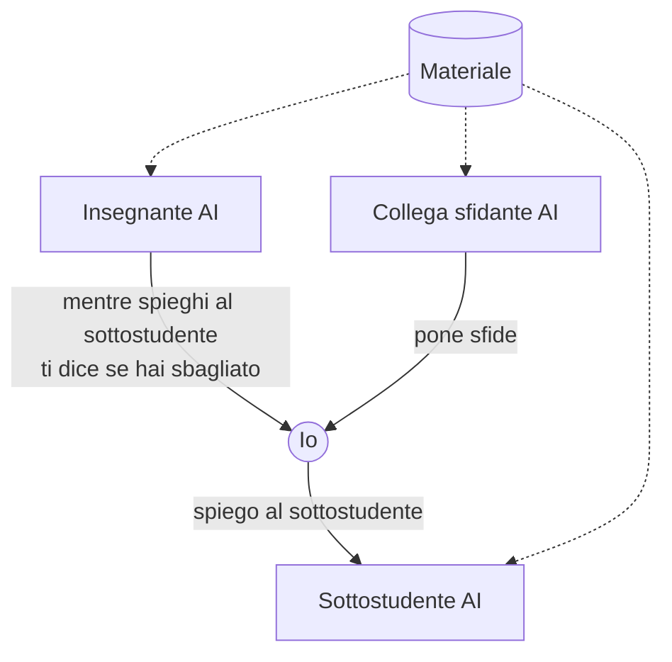

# Teaching for Learning

> *The best way for learning is teaching*

## Obiettivi

- Miglioramento della didattica
- Migliori risultati per il docente
- Migliore benessere per gli studenti

## Funzionamento

1. Lo studente va a lezione
2. L'insegnante mostra le slide e carica i dati su RAG
3. Lo studente studia secondo il loop sottostante

### Il loop

- **Insegnante AI**: mentre spieghi al sottostudente "stupido", ti dice se hai sbagliato
- **Collega sfidante AI**: ti pone sfide
- **Sottostudente AI**: è quello a cui spieghi

### Materiale

- LLM preaddestrato
- Materiale del docente
- Materiale dello studente

### Allo studente rimane

- Capacità di esporre
- Capire i propri errori
- Grafo di conoscenza

*Nota a margine: esame interno*

## Feature

- **Libreria di vari corsi**
  - Ogni corso può essere creato dallo studente con il suo materiale, oppure creato dal docente e poi pubblicato
- **Feedback istantaneo al docente**
- **Loop come pagina successiva**
- **Spaced repetition** — ripasso a intervalli crescenti per contrastare la curva dell'oblio (grafico: ritenzione nel tempo `t`, che cala e risale a ogni ripasso)

## Costi

- **Per l'azienda**
  - Running server
  - Unico modello preaddestrato → singolo agente per studente
  - Costi di elettricità
- **Per l'università**
  - Pagare il servizio
- **Per gli studenti**
  - Gratis
